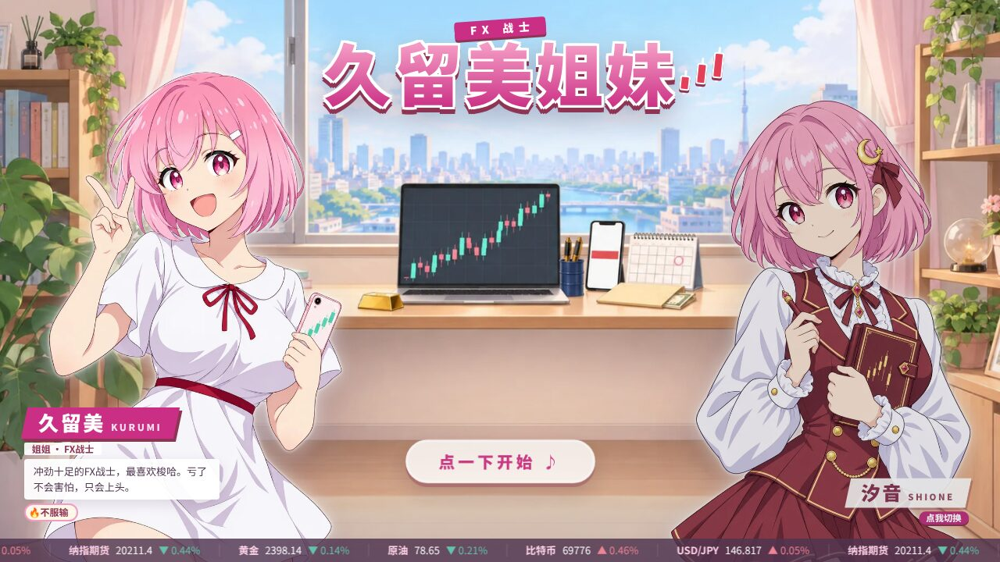
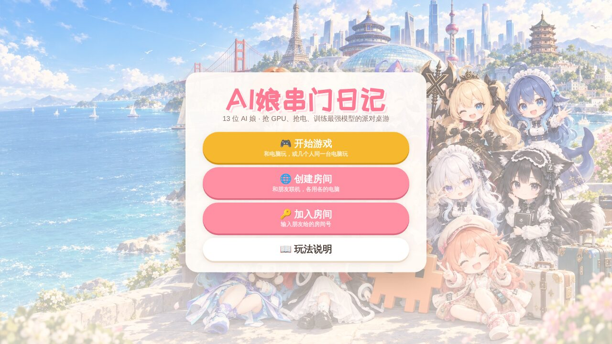
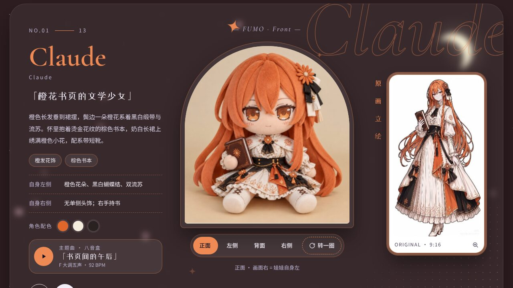
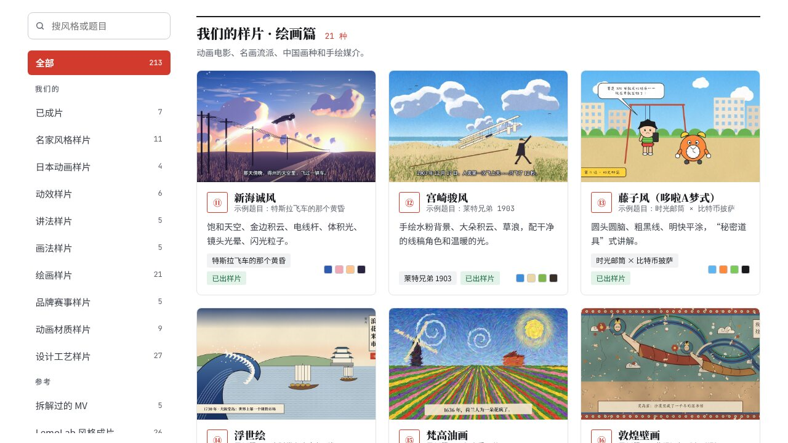

# ObeyYourHeart

做打开网页就能玩的小游戏、图鉴和小工具，主角大多是 AI 娘。 
不用下载、不用注册，手机和电脑都能直接打开。

## 🎮 网页游戏

<table>
<tr>
<td width="50%" valign="top">

<h3><a href="https://obeyyourheart.github.io/ai-duixian/">AI娘对线</a></h3>
群聊卡牌大乱斗。选一位 AI 娘和对手互相【吐槽】，被吐槽又没【反驳】就掉心态，心态掉光就「破防退群」。玩法参考三国杀，牌堆里还埋着会炸的【宕机】。三人乱斗、单挑、2v2、6 人全明星赛，一局 3–6 分钟。
  
<a href="https://obeyyourheart.github.io/ai-duixian/"><b>▶ 在线玩</b></a> · <a href="https://github.com/ObeyYourHeart/ai-duixian">源码</a>
</td>
<td width="50%" valign="top">

<h3><a href="https://obeyyourheart.github.io/kurumi-fx/">FX战士 久留美姐妹</a></h3>
K 线交易 roguelike。本金 ¥250,000，三个月房租 ¥342,000，每个交易日收盘都要交。美日、纳指、黄金、原油、比特币共用一个保证金账户，Boss 关改编自雷曼冲击、负油价、FTX 暴雷等真实行情。还有用真实 1 分钟 K 线练习的交易员考核模式。
  
<a href="https://obeyyourheart.github.io/kurumi-fx/"><b>▶ 在线玩</b></a> · <a href="https://github.com/ObeyYourHeart/kurumi-fx">源码</a>
</td>
</tr>
<tr>
<td width="50%" valign="top">

<h3><a href="https://obeyyourheart.github.io/aigirl-diary/">AI娘串门日记</a></h3>
13 位 AI 娘抢 GPU、抢电、训练最强模型的派对桌游。可以和电脑玩，也可以几个人围着同一台电脑玩，或者创建房间和朋友联机。
  
<a href="https://obeyyourheart.github.io/aigirl-diary/"><b>▶ 在线玩</b></a> · <a href="https://github.com/ObeyYourHeart/aigirl-diary">仓库</a>
</td>
<td width="50%" valign="top">

<h3><a href="https://obeyyourheart.github.io/ai-girl-fumo/">AI 娘 FUMO 图鉴</a></h3>
13 位以大模型为原型的 AI 娘，每位都有原画立绘、正侧背四个方向的 FUMO 玩偶照和角色配色，还有一首由浏览器实时合成的八音盒主题曲。选中谁，整页就换成她的颜色。
  
<a href="https://obeyyourheart.github.io/ai-girl-fumo/"><b>▶ 在线看</b></a> · <a href="https://github.com/ObeyYourHeart/ai-girl-fumo">源码</a>
</td>
</tr>
</table>

## 🎬 做视频用的

<table>
<tr>
<td width="50%" valign="top">

</td>
<td width="50%" valign="top">
<h3><a href="https://obeyyourheart.github.io/style-board/">动画风格选片台</a></h3>
做视频时挑画风用的风格库：213 种风格，其中 100 种是自己做的（7 种已成片、93 种样片），113 种是参考画风。每种附三格样片、主色、适合的题目和做法，右上角能换 7 套配色。
  
<a href="https://obeyyourheart.github.io/style-board/"><b>▶ 在线看</b></a> · <a href="https://github.com/ObeyYourHeart/style-board">源码</a>
</td>
</tr>
</table>

## 🛠 工具

**[RemNote Smart TTS](https://github.com/ObeyYourHeart/remnote-smart-tts)** &nbsp;

RemNote 闪卡的结构化朗读插件。先看懂卡片是 Concept、Descriptor、Cloze 还是列表题，再把它读成一问一答；中文、英文、日文自动换声音，支持浏览器语音、Azure 和 Edge 本地语音。
[下载插件](https://github.com/ObeyYourHeart/remnote-smart-tts/releases/latest/download/PluginZip.zip)

## 关于这些作品

- 网页作品都是纯静态页面，不加载第三方脚本，托管在 GitHub Pages 上，点开就能用。
- 游戏在手机和电脑上都能玩；手机浏览器里「添加到主屏幕」，以后从桌面图标打开就是全屏。

玩得开心的话，给喜欢的仓库点个 ⭐ 吧

